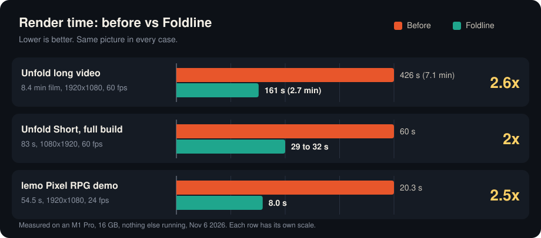
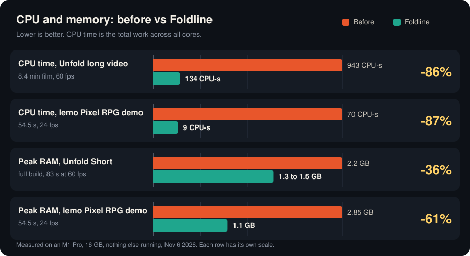

<div align="center">

# Foldline

**Render HTML canvas animations to MP4, fast, on a Mac.**<br>
With the full lemo-opuscar library of 66 film styles made in code.

Made for **Unfold**, an animated "What if" channel in a paper pop-up book style.<br>
<a href="https://www.youtube.com/@UnfoldAnimated"></a>

</div>

<!-- DEMO VIDEO: the explainer below was rendered by Foldline. The player is a GitHub upload; the YouTube link is the fallback. -->
https://github.com/user-attachments/assets/05724852-c9ae-4762-90a9-634315b2b016

<p align="center">
  <b>▶ <a href="https://youtu.be/VWgjNfQqT7k">Watch on YouTube</a></b> · <a href="https://github.com/alireza12t/foldline/releases/download/v1.0.0/foldline-explainer.mp4">download the MP4</a> · <a href="https://medium.com/@devmvrick/part-2-i-made-my-code-drawn-videos-render-up-to-2-6x-faster-on-a-mac-free-open-source-3500fed32b95">read the deep dive on Medium</a><br>
  <sub>Made with Foldline itself: every frame drawn in code, a local text-to-speech voice, music synthesised in code. It renders in 34 s. Source in <a href="examples/foldline-explainer/">examples/foldline-explainer</a>.</sub>
</p>

## What it is

Foldline turns a web page that draws a film in code into an H.264 MP4. You write an HTML page with a `<canvas>` and a `render(t)` function. Foldline opens it in headless Chrome, draws every frame, and encodes the video inside the page with WebCodecs on the Mac's hardware encoder, so frames never leave the GPU. On an M1 Pro, an 8.4-minute 1080p 60 fps video renders in 161 s instead of 426 s (see [Results](#results)). It's open source and free for non-commercial use, and it works well with coding agents like Claude Code.

Foldline is a project by Alireza Toghiani, built for the Unfold channel. It isn't a GitHub fork. It ships the full [lemo-opuscar](https://github.com/lemomo-ai/lemo-opuscar) library by LemoLab:

- all 66 film styles in `styles/`, each with a style prompt and a demo film made in code
- the toolkit in `core/` (render, voice, music, mix)
- the guides [`DIRECTOR.md`](DIRECTOR.md), [`TECHNIQUE.md`](TECHNIQUE.md) and [`MY-STYLES.md`](MY-STYLES.md)
- lemo's Claude Code plugin in `plugin/`

lemo's original README is kept as [`LEMO-README.md`](LEMO-README.md). It has the style list, how to make a style your own, and the full requirements.

What Foldline adds is a faster video renderer, `core/render/video.mjs`, an MCP server for coding agents, `core/mcp/server.mjs`, and a local Qwen3-TTS voice engine, `core/tts/tts_qwen.py`.

## What's new vs lemo-opuscar

- **The page encodes the video itself.** By default `video.mjs` encodes H.264 inside the page with WebCodecs, on the Mac's hardware encoder. Each frame goes from the canvas to the encoder on the GPU. No screenshot, no JPEG, no ffmpeg decode.
- **It works when the film draws into one visible `<canvas id="c">` of the render size.** 35 of the 66 lemo demos do, and Unfold's videos do.
- **Automatic fallback.** If the page doesn't fit that, or the browser has no hardware H.264 encoder, it falls back to the screenshot path with the Mac hardware encoder (VideoToolbox). If that isn't available either, it uses x264.
- **`FOLDLINE_ENC=auto|wc|vt|x264`** picks the encoder. `auto` is the default. `x264` is lemo's original path. `LEMO_ENC` still works.
- **`FOLDLINE_MBPS`** sets the bitrate for the WebCodecs path, in Mbit/s (default 20).
- **New flag `--audio <file>`** muxes a sound file in (AAC 192k). It runs as a second ffmpeg pass from the finished mp4. The picture is never cut to the sound: a soundtrack shorter than the film is padded with silence to the end, and a longer one is cut at the end. Add `--allow-short-audio` when the sound is meant to stop early.
- **The finished file is checked before it's saved**, not just for which streams it has: every rendered frame must decode (one frame of slack), the picture must run from 0 to the film's length, and the soundtrack must start with it and end with it (or before it, with `--allow-short-audio`). A file that ends early, after a missing chunk or a muxing mistake, fails the render and isn't saved.
- **Output** is standard bt709 limited-range H.264 mp4.
- **MCP server** in `core/mcp/`: agents get the styles, guides, renders and sound tools as MCP tools with short results. See [MCP server](#mcp-server).
- **Qwen3-TTS voice** in `core/tts/tts_qwen.py`: a third voice engine beside Kokoro and edge-tts, local on Apple silicon, with fixes for cut endings and misread numbers and a Whisper check that redoes bad takes. See [Voice with Qwen3-TTS](#voice-with-qwen3-tts).

Everything else in the library works the way lemo describes it.

## How it compares

Foldline is a renderer plus a style library, not a framework or a timeline editor. You write the page, Foldline renders it.

| | **Foldline** | lemo-opuscar (original) | [Remotion](https://github.com/remotion-dev/remotion) | [Motion Canvas](https://github.com/motion-canvas/motion-canvas) | [HyperFrames](https://github.com/heygen-com/hyperframes) |
|---|---|---|---|---|---|
| **You write** | an HTML page with `render(t)` | an HTML page with `render(t)` | React components | TypeScript scenes | HTML, CSS and seekable animations (GSAP, Lottie, three.js and others) |
| **How frames are made** | Chrome draws the canvas, and the page hands each frame to the encoder (WebCodecs). Frames stay on the GPU. | Chrome draws the page, and each frame is taken as a JPEG screenshot | Chrome draws each frame, and FFmpeg encodes them | the browser saves each frame as an image file (PNG, JPEG or WebP) | headless Chrome (Puppeteer) seeks each frame, and FFmpeg encodes them |
| **Video encoder by default** | Mac hardware H.264, falling back to VideoToolbox, then x264 | x264 (software) | FFmpeg, H.264. Hardware encoding (VideoToolbox on Mac, NVENC) is available but off by default. | none built in: you turn the images into a video yourself, for example with ffmpeg | FFmpeg |
| **Ready-made looks** | 66 film styles, each with a demo film (lemo's library) | the same 66 film styles | starter templates | none in the core | about 450 blocks and components, plus design templates |
| **Code licence** | PolyForm Noncommercial: free for non-commercial use, commercial licence on request (lemo's original code stays MIT) | MIT | Remotion License: free for individuals, non-profits and companies of up to 3 employees, paid above that | MIT | Apache-2.0 |
| **Speed, measured here** | 2.5x faster than lemo on its Pixel RPG demo, 2.6x faster on an 8.4 min film | the baseline | not measured here | not measured here | not measured here |

Sources, checked Nov 6 2026: Remotion's [encoding](https://www.remotion.dev/docs/encoding) and [hardware acceleration](https://www.remotion.dev/docs/hardware-acceleration) docs, Motion Canvas's [rendering](https://motioncanvas.io/docs/rendering/) docs and the [HyperFrames README](https://github.com/heygen-com/hyperframes). Projects change, so check their docs for the latest. Foldline's speed numbers are in [Results](#results).

## Install

You need:

- **macOS on Apple Silicon** (recommended). The fast path needs Chrome's hardware H.264 encoder. Other systems fall back to the screenshot path.
- **Node 20+**
- **ffmpeg 7+**
- **Python 3.11+**, for the voice and music tools

```sh
git clone https://github.com/alireza12t/foldline.git
cd foldline
npm ci
node node_modules/playwright-core/cli.js install chromium-headless-shell
```

The last line installs the headless Chrome the renderer uses, the same way lemo's setup script does it. To use a different Chrome or headless-shell executable, set `PLAYWRIGHT_CHROME=/path/to/chrome-headless-shell`.

For the Python tools (sound effects, mix, subtitles, voice), lemo's setup script makes the `.venv` in tiers. Run it from the repo folder:

| Command | Adds |
|---|---|
| `sh plugin/skills/lemo-opuscar/scripts/setup.sh deps` | npm packages, headless browser, Python `.venv` core tier |
| `sh plugin/skills/lemo-opuscar/scripts/setup.sh deps voice` | Kokoro, edge-tts, faster-whisper, and the Kokoro model |
| `sh plugin/skills/lemo-opuscar/scripts/setup.sh deps music` | numba, for `pluck.py` |
| `sh plugin/skills/lemo-opuscar/scripts/setup.sh deps qwen` | mlx-audio and faster-whisper for the [Qwen3-TTS voice](#voice-with-qwen3-tts) (Mac with Apple silicon; the model downloads on first use) |

### Optional big assets

These aren't in git. Fetch them only when a film needs them. `tools/fetch.sh` downloads them from lemo-opuscar's `assets` release on GitHub.

| Command | What it gets | Size |
|---|---|---|
| `sh tools/fetch.sh voice` | Kokoro TTS model (English, offline) into `core/tts/` | about 354 MB |
| `sh tools/fetch.sh hdri` | Poly Haven HDRIs for the 3D styles into `core/assets/polyhaven/` | 12 MB |
| `sh tools/fetch.sh instruments <lib>` | one sample library (`freepats`, `karoryfer`, `salamander`, `vcsl`, `vsco2ce`, or `all`) | 70 to 400 MB each |

Full sizes and details are in [`TECHNIQUE.md`](TECHNIQUE.md) §1.

## Usage

Run every command from the repo folder.

### Render a library demo

```sh
node core/render/video.mjs styles/rubber-hose/demo --fps 24 --out out/rubber-hose.mp4
```

Some demos need a one-time setup in their own folder first:

- `npm ci` if the demo has a `package.json`
- `node fetch_fonts.mjs` if it has one

### Render your own page

```sh
node core/render/video.mjs my-film --size 1080x1920 --fps 60 --audio my-film/mix.wav --out my-film/out/video.mp4
```

`my-film` is any folder with an `index.html` that follows the page contract below.

### Stills

```sh
node core/render/still.mjs <dir> 3 20 --out <dir>
```

This writes review JPEGs at 3 s and 20 s. See [`core/README.md`](core/README.md) for `--range` and `--prefix`.

### Flags

| Flag | Default | Meaning |
|---|---|---|
| `--fps` | 24 | frames per second |
| `--size WxH` | 1920x1080 | render size, even numbers |
| `--workers` | 3 | parallel browsers; up to 6 for a single render |
| `--out` | `<demo>/out/video.mp4` | output file; each parallel render needs its own |
| `--q 'k=v&…'` | none | reaches the page as `location.search` |
| `--audio <file>` | none | mux a sound file in (AAC 192k); new in Foldline |
| `--allow-short-audio` | off | with `--audio`: let a soundtrack shorter than the film end early instead of padding it with silence |

### Environment variables

| Variable | Default | Meaning |
|---|---|---|
| `FOLDLINE_ENC` | `auto` | `auto` (WebCodecs, else VideoToolbox, else x264), `wc`, `vt`, or `x264` (lemo's original path). `LEMO_ENC` still works |
| `FOLDLINE_MBPS` | 20 | bitrate in Mbit/s for the WebCodecs path |
| `LEMO_VTQ` | 72 | quality for the VideoToolbox screenshot path |

The rest of lemo's variables (`PLAYWRIGHT_CHROME`, `LEMO_ANGLE`, `RENDER_SLOTS` and more) are listed in [`core/README.md`](core/README.md).

### The page contract

This comes from lemo. Each film is a folder with an `index.html` that sets:

```js
window.DUR = 54.2;                 // film length in seconds
window.render = (t) => { ... };    // draw the frame at t seconds; may be async
window.READY = true;               // set once fonts and assets are loaded
```

For the fast path, draw the whole film into one visible `<canvas id="c">` of the render size. Any other page still renders, through the screenshot path.

### Voice with Qwen3-TTS

Besides Kokoro and edge-tts, Foldline has a third voice engine: [Qwen3-TTS](https://huggingface.co/Qwen/Qwen3-TTS-12Hz-1.7B-CustomVoice), running on the Mac through [mlx-audio](https://github.com/Blaizzy/mlx-audio). It's free, it needs no account, and each line can say how it should sound. It needs a Mac with Apple silicon.

Listen to [`examples/qwen-voice/demo.wav`](examples/qwen-voice/demo.wav): 15 s, two of the built-in voices, made from [`examples/qwen-voice/lines.json`](examples/qwen-voice/lines.json) with this command:

```sh
sh plugin/skills/lemo-opuscar/scripts/setup.sh deps qwen
.venv/bin/python core/tts/tts_qwen.py examples/qwen-voice/lines.json out/voices
```

It writes one trimmed `<id>.wav` per line and `dur.json`, like `tts.py`. The first run downloads the model, `mlx-community/Qwen3-TTS-12Hz-1.7B-CustomVoice-8bit` (about 3.1 GB), and Whisper `small.en` for the check (about 0.5 GB). On an M1 Pro with 16 GB, the three demo lines took 21 s with the model already downloaded, and memory peaked at 4.2 GB.

**Faster and lighter than plain Qwen.** Lines are made together in one batch with the model loaded once, and the model is slimmed for preset voices (8-bit embeddings, a half-precision decoder that runs in small chunks, no voice-cloning encoder). On the same 8 lines and the same Mac, plain mlx-audio Qwen3-TTS (one line at a time) took 22.7 s for 31 s of speech and peaked at 6.5 GB of memory. Foldline took 16.2 s for 38 s of speech and peaked at 4.3 GB: about 1.7x faster per second of speech, with a third less memory. The gain grows with more lines; on a 13-line test it was 2.2x per line.

Each line is `{id, text}` plus any of these:

| Field | Meaning |
|---|---|
| `voice` | `ryan` (default) or `aiden` for English; `vivian`, `serena`, `uncle_fu`, `dylan`, `eric` for Chinese; `ono_anna` for Japanese; `sohee` for Korean |
| `instruct` | how to say it, in plain words, for example `"A warm, clear narrator, natural pace"` |
| `lang` | `english` (default), `chinese`, `japanese`, `korean`, `german`, `french`, `russian`, `portuguese`, `spanish` or `italian` |
| `say` | what is spoken, when it differs from `text` |
| `asr` | what Whisper should hear, when it differs from what is spoken |

`--voice` and `--instruct` set a default for every line. `--batch 16` is how many lines are made together (lower uses less memory), `--retries 3` how many rounds of redos, `--seed` fixes the randomness, and `--model` takes another Qwen3-TTS CustomVoice repo or a local folder. Agents get the same through the MCP server: `make_voice` with `engine: "qwen"`.

**What it fixes.** The plain model has two problems, found and measured while making the voice for the Unfold channel:

- **Takes that end mid-sound.** Qwen3-TTS often picks its end token on a frame where the last sound is still loud. It's more than 99% sure each time, so it isn't bad luck in sampling. Nothing comes after that frame, so the audio stops on a loud sample: a hard chop on the last word. The fix: when a take first picks the end token, it has to make one more frame, which the model fills with silence, so the last sound finishes. Tested with this code on this model, 7 narration lines made 6 times each: 6 of the 42 takes were cut without the fix, 0 with it. Earlier runs of the plain model cut 11 of 42 and 11 of 48, about 1 in 4. Every take also gets a 10 ms fade at the end.
- **Numbers read wrong.** Qwen reads digits one token at a time and guesses the reading, so years come out rushed or as another number ("In 1947." came out as 1967). In a test of 8 takes of 3 lines, digits gave a wrong number in 3 of 24 takes and words in 0 of 24. So English digits are spelled as words first: 1947 becomes "nineteen forty-seven", and $5 million, $1.50, 10%, 19th, 1990s, 9:30, 10pm and 1939-1945 work too. Keep the digits in your subtitles.

**The guard.** Every take is checked for a cut end (voice still in the last 50 ms) and, in English, by Whisper on the CPU. A take fails when a number or the last word is missing, fewer than 85% of the words are heard, or a number is said too fast to follow (over 12.5 syllables a second; good takes reach 10.9). Failing takes are made again, up to 3 rounds. A line that still fails keeps its best try and is printed as `STILL FAILING`, so you know which one to listen to. The check costs about 1 s per take; `--no-check` keeps only the cut check. On eight hard test lines (years at the end, money, a Chinese line), nothing still failed, and the whole run took 27 s.

### Using it with a coding agent

lemo's plugin and skill are for Claude Code. How to install them, and how to ask for a film, is in [`LEMO-README.md`, How to use](LEMO-README.md#how-to-use). The plugin installs lemo's own library into `~/lemo-opuscar`. lemo's setup script uses the clone you're standing in when it's a library, so to work with Foldline's renderer, start your agent inside this folder (lemo's "clone the repo" option).

### MCP server

Foldline has an MCP server, so Claude Code, Codex, Cursor and other agents can call its tools directly instead of reading the guides and running commands by hand. It's on npm as [`foldline-mcp`](https://www.npmjs.com/package/foldline-mcp), and it's listed in the [MCP Registry](https://registry.modelcontextprotocol.io) as `io.github.alireza12t/foldline`.

You need Node 20+, ffmpeg (`brew install ffmpeg`) and Chrome's headless shell, installed once with `npx playwright-core@1.63.0 install chromium-headless-shell`. The server tells you if one is missing.

**Claude Code**, as a plugin (the MCP server plus a Foldline skill):

```sh
claude plugin install foldline --marketplace alireza12t/foldline
```

or as a plain MCP server:

```sh
claude mcp add --scope user foldline -- npx -y foldline-mcp
```

**Codex**, in `~/.codex/config.toml`:

```toml
[mcp_servers.foldline]
command = "npx"
args = ["-y", "foldline-mcp"]
```

**Cursor** (`~/.cursor/mcp.json`), **Claude Desktop** and most other clients:

```json
{ "mcpServers": { "foldline": { "command": "npx", "args": ["-y", "foldline-mcp"] } } }
```

**VS Code** (`.vscode/mcp.json`):

```json
{ "servers": { "foldline": { "command": "npx", "args": ["-y", "foldline-mcp"] } } }
```

To use your own clone instead of npm, point the command at it: `node /path/to/foldline/core/mcp/server.mjs`. Inside this folder, Claude Code finds it on its own through `.mcp.json`.

| Tool | What it does |
|---|---|
| `find_styles` | search the 66 styles, one short line each |
| `get_style` | a style's prompt (`STYLE.md`), optionally with how its demo was made |
| `read_guide` | a guide's table of contents, or one section of it |
| `render_stills` | review stills, optionally as one contact sheet image |
| `render_video` | the full render; returns only the done line (path, frames, time, encoder) |
| `check_reading` | on-screen text timing; returns only the failures |
| `export_events` | the page's sound cues to JSON |
| `make_voice`, `check_voice` | Kokoro, Edge TTS or Qwen3-TTS, then a Whisper check |
| `mux_audio` | mix under the video, mastered to -14 LUFS |
| `make_subtitles` | an `.srt` from cues |
| `fetch_assets` | downloads the voice model, the HDRI skies for 3D styles, or an instrument library |

It's built to save tokens. Results are short, a guide comes one section at a time, and renders don't stream their progress log into the chat. Renders run at low priority (`nice`). The voice, sheet and subtitle tools use Python from `FOLDLINE_PYTHON`, the library's `.venv` or `~/lemo-opuscar/.venv`, in that order.

## Results

Measured on an M1 Pro with 16 GB, nothing else running, Nov 6 2026.

<p align="center">
  
</p>
<p align="center">
  
</p>

The tables below have every number behind the charts.

### Unfold Short

Part 3: 83 s, 1080x1920, 60 fps, 4-sample motion blur.

| Render path | Render time | Full build | Peak RAM |
|---|---|---|---|
| Screenshots + x264 (the original) | 69-88 s | not measured | 3.0 GB |
| JPEG frames from the canvas + hardware encoder | 45 s | 60 s | 2.2 GB |
| **Foldline: WebCodecs in the page** | **29 s** | **29-32 s** (runs: 29.4, 29.0, 31.8) | **1.3-1.5 GB** |

The full build also mixes the audio. Foldline's build runs the mix during the render instead of before it.

### Unfold long video

EP9: the full 8.4 min, 1920x1080, 60 fps.

| | Screenshots + hardware encoder | Foldline |
|---|---|---|
| Render time | 426 s | 161 s (runs: 161.8, 161.5; 187 fps) |
| CPU time | 943 CPU-seconds | 134 CPU-seconds (-86%) |
| Peak RAM | about 1.5 GB | about 1.5 GB |

### Picture quality

- Frames compared against the original canvas PNGs score 38-39 dB on both the old and the new path. That's the normal colour conversion to video, not the encoder.
- Old vs new long video: 42.3 dB on average, lowest frame 39.6 dB.
- Identical to the eye.

### lemo demos

<!-- BENCH:LEMO-DEMOS -->
lemo's Pixel RPG demo: 54.5 s, 1920x1080, 24 fps, 3 workers, two runs each. It's the one single-canvas demo that renders without downloading extra fonts first.

| Demo | lemo original (x264) | Foldline | Speed-up | CPU time | Peak RAM |
|---|---|---|---|---|---|
| pixel-rpg | 20.8 s, 19.8 s | 8.1 s, 8.0 s (177 fps) | 2.5x | 70 to 9 CPU-seconds | 2.85 to 1.1 GB |

Picture: 47.7 dB on average between the two outputs, lowest frame 42.1 dB.
<!-- /BENCH:LEMO-DEMOS -->

### Where the time goes

Drawing a frame takes about 4 ms on the GPU. The ceiling now is the Mac's single hardware H.264 encoder. It does about 165-185 fps at 1080x1920, and all workers share it.

### Tried and dropped

- **Rendering without Chrome.** Node + Skia on the CPU was 18x slower per frame. Node + Skia on Metal (skia-canvas) topped out at 30 fps, 3.5x slower.
- **Chrome's software encoder.** No faster in real renders, and it used more CPU.
- **Mixing hardware and software encoders in one file.** Too risky for Instagram uploads.

## FAQ

**How do I render an HTML canvas animation to MP4?**
Make a folder with an `index.html` that sets `window.DUR`, `window.render(t)` and `window.READY` ([the page contract](#the-page-contract)). Draw the film into one `<canvas id="c">` of the render size. Then run `node core/render/video.mjs my-film --size 1920x1080 --fps 60 --out my-film.mp4`. Foldline opens the page in headless Chrome, calls `render(t)` for every frame and writes an H.264 MP4.

**Is it faster than screenshots + ffmpeg?**
In our tests, yes. The 8.4-minute Unfold video took 426 s with screenshots and the Mac's hardware encoder, and 161 s with Foldline, with 86% less CPU time. lemo's Pixel RPG demo rendered 2.5x faster than lemo's original screenshots + x264 path. All numbers are in [Results](#results).

**Why is it faster?**
The screenshot path copies each frame out of the browser as a JPEG, then ffmpeg decodes it and encodes it again. Foldline hands the canvas straight to Chrome's WebCodecs `VideoEncoder` with hardware acceleration, so the frame stays on the GPU. Drawing a frame takes about 4 ms. The limit now is the Mac's hardware H.264 encoder.

**Does it work on Windows or Linux?**
It's built and tested on a Mac with Apple Silicon. The fast path needs Chrome's hardware H.264 encoder. When Chrome doesn't offer one, Foldline falls back to the screenshot path. VideoToolbox is Mac only, so on other systems that means x264, lemo's original path. It still renders, just not faster. We haven't tested Windows or Linux.

**Does my page have to be a single canvas?**
For the fast path, yes: one visible `<canvas id="c">` of the render size, and nothing else visible. Any other page (DOM elements, SVG, several canvases) still renders, through the screenshot path. 35 of the 66 lemo demos fit the fast path.

**Does the video look different?**
Not to the eye. The old and new long video differ by 42.3 dB on average (lowest frame 39.6 dB). Output is standard bt709 limited-range H.264 mp4.

**Can I add sound?**
Yes. `--audio my-film/mix.wav` muxes the file in as AAC 192k. A shorter mix is padded with silence, never used to cut the picture; pass `--allow-short-audio` if it's meant to end early. Before saving, the renderer decodes the result and refuses it if it's missing a stream, has fewer frames than were rendered, or its sound doesn't line up with the start and end of the film.

**What is lemo-opuscar?**
[lemo-opuscar](https://github.com/lemomo-ai/lemo-opuscar) is LemoLab's open library of film styles made in code, for Claude Code. Each of the 66 styles has a style prompt and a demo film drawn entirely in code, with no video model. Foldline includes all of it. Foldline changed the video renderer and added an MCP server (see [`NOTICE.md`](NOTICE.md)).

**Can I use it with Claude Code or another coding agent?**
Yes. lemo's Claude Code plugin is in `plugin/`, and agents that read [`AGENTS.md`](AGENTS.md) get the same guide. Start the agent inside this folder so it uses Foldline's renderer. Details are in [Using it with a coding agent](#using-it-with-a-coding-agent). Any agent that speaks MCP can also use the [MCP server](#mcp-server).

**Is it free?**
Yes, for anything non-commercial: personal projects, learning, research, hobby films and open work you don't get paid for. You can read, change and share the code in public. It needs only free tools: Node, ffmpeg and Chrome's headless shell.

**Can I use it to make money?**
Not without a commercial licence. That covers selling Foldline or a service built on it, and paid work made with it, like client videos or monetized channels. To ask for a licence, [open an issue](https://github.com/alireza12t/foldline/issues/new?title=Commercial%20licence) with "Commercial licence" in the title. lemo's original code is MIT and free for any use from [lemo's repository](https://github.com/lemomo-ai/lemo-opuscar).

## Credits

- **[LemoLab / lemo-opuscar](https://github.com/lemomo-ai/lemo-opuscar)** by Lemomo ([@lemomo_ai](https://x.com/lemomo_ai) on X). The whole style library, the toolkit, the guides, the page contract and the render pipeline Foldline builds on. lemo's styles were made with Claude Opus 5.5. Code MIT; demo films and stills CC BY 4.0.
- **[Playwright](https://playwright.dev/)** drives the headless browser.
- **[Chromium](https://www.chromium.org/)** draws the frames and, through WebCodecs, encodes them.
- **[FFmpeg](https://ffmpeg.org/)** wraps, joins and muxes the video.
- **[three.js](https://threejs.org/)** for the 3D styles.
- **[Poly Haven](https://polyhaven.com/)** for the CC0 HDRIs and models.
- **[Kokoro TTS](https://huggingface.co/hexgrad/Kokoro-82M)** for offline narration.
- **[Qwen3-TTS](https://huggingface.co/Qwen/Qwen3-TTS-12Hz-1.7B-CustomVoice)** by the Qwen team (Apache-2.0), run through **[mlx-audio](https://github.com/Blaizzy/mlx-audio)** (MIT), and **[faster-whisper](https://github.com/SYSTRAN/faster-whisper)** for the voice check.
- **[Google Fonts](https://fonts.google.com/)** for fonts used in the demos.
- Third-party assets in the demos keep their own licences (see each demo's `CREDITS`).

Foldline's changes to lemo-opuscar are listed in [What's new vs lemo-opuscar](#whats-new-vs-lemo-opuscar).

## Licence

- **Foldline's code**: [PolyForm Noncommercial 1.0.0](LICENSE), copyright Alireza Toghiani. Free to use, change and share for any non-commercial purpose. Commercial use needs a licence: [open an issue](https://github.com/alireza12t/foldline/issues/new?title=Commercial%20licence) with "Commercial licence" in the title.
- **lemo-opuscar's original code**: [MIT](licenses/lemo-opuscar-MIT.txt), copyright LemoLab. [`NOTICE.md`](NOTICE.md) says which parts are which.
- Copies downloaded before November 7, 2026 were MIT and stay MIT.
- **Demo films and their stills** from lemo-opuscar (in `styles/`): [CC BY 4.0](https://creativecommons.org/licenses/by/4.0/). Credit **LemoLab** with a link to [the lemo-opuscar repository](https://github.com/lemomo-ai/lemo-opuscar), and say if you changed them.
- **Three voice tracks are not CC BY 4.0**: the shouts in Game Show Flat (macOS system voices, `say`), the narration in Paper-cut Lightbox (Microsoft Edge TTS), which will be re-voiced with Kokoro, and the narration in Broadcast News Package (Doubao TTS, under Volcengine's terms). They are excluded from the licence above. Don't reuse them; in your own films use Kokoro (the default) or a voice you have the right to use.
- **Films you make with it**: yours. If you make them to earn money, you need a commercial licence for Foldline first.

---

<div align="center">

Made for **[Unfold](https://www.youtube.com/@UnfoldAnimated)**.<br>
Thank you to LemoLab for lemo-opuscar, which all of this is built on.

</div>
